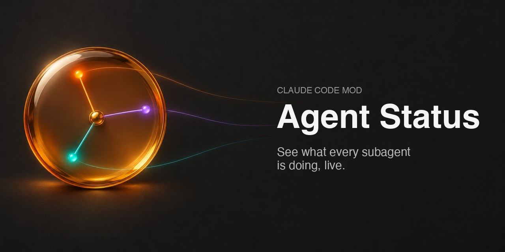
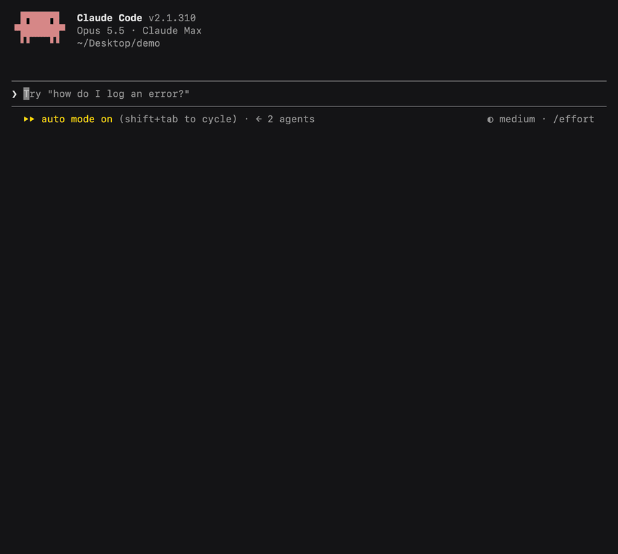
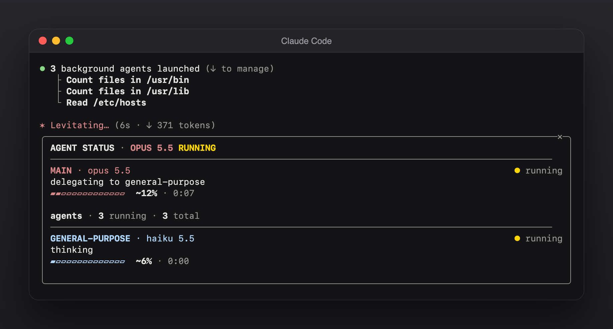
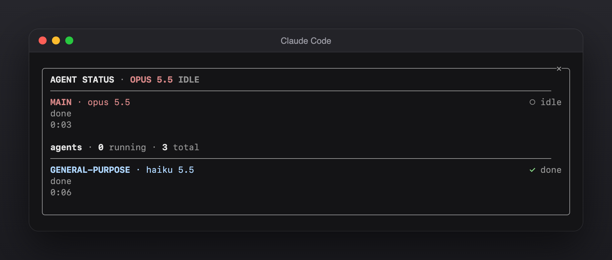
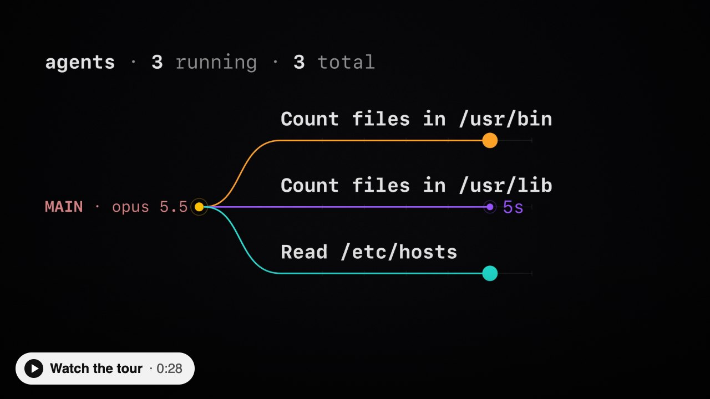

<p align="center"></p>

<h1 align="center">Agent Status for Claude Code: see what every subagent is doing</h1>

<p align="center">Agent Status is a Claude Code mod that opens a side panel showing what the main thread and each subagent is doing right now, how far along it is and which model it runs on. Type <code>/agent-status</code>.</p>

<p align="center">
  <a href="LICENSE"></a>
  
  
</p>

<p align="center"><a href="#install">Install</a> · <a href="#what-it-looks-like">What it looks like</a> · <a href="#faq">FAQ</a> · <a href="#watch-it">Watch the tour</a></p>

<p align="center"></p>

## Install

In Claude Code:

```
/plugin install agent-status --marketplace hg913488/claude-code-agent-status
```

Then type `/agent-status` to open the panel. It updates by itself while Claude works.

In the desktop app, click **+** next to the prompt box → **Plugins** → **Add marketplace** → `hg913488/claude-code-agent-status` → **Add plugin**.

## What it looks like

<p align="center"><br><sub><b>While they run</b> · what each one is doing, its model and progress</sub></p>

<p align="center"><br><sub><b>When they finish</b> · ✓ done, and how long each took</sub></p>

## What the panel shows

- **The main thread** at the top: its model (`OPUS 5.5`) and whether it's running, done or idle.
- **Every subagent** below it, labelled by type (`EXPLORE`, `PLAN`), with its model. A subagent on a different model from the main thread is shown in another colour, so a cheaper Haiku helper stands out.
- **What each one is doing**, in plain words: `reading register.tsx`, `searching web: tauri notarize`, `delegating to Explore`.
- **Progress**: tasks done out of total (`3/5 tasks`) when Claude keeps a task list, or an estimate (`~60%`) from the steps taken so far.
- **Time**: how long each one has been running, ticking every second.

It keeps the main thread plus the 12 most recent subagents.

## FAQ

**How do I see what Claude's subagents are doing?**
Install the mod and type `/agent-status`. The panel lists each subagent with its current action, progress and model.

**Which model is each subagent using?**
The panel shows it next to each name, like `haiku 5.5`. One that differs from the main thread's model is highlighted.

**Is the percentage exact?**
Only when Claude keeps a task list: then it's tasks done out of total. Without one it's an estimate from the steps taken, and it never shows more than 90% until the agent finishes.

**Does it slow Claude down or change what it does?**
No. It only watches events Claude Code already sends and draws the panel. Nothing is added to Claude's prompt.

**How do I uninstall it?**
`/plugin uninstall agent-status`, or `claude plugin uninstall agent-status` from a shell.

## Watch it

[](assets/agent-status-tour.mp4)

A 28-second tour of a multi-agent run. Click to play.

---

MIT licensed. Made by [HG](https://github.com/hg913488).
